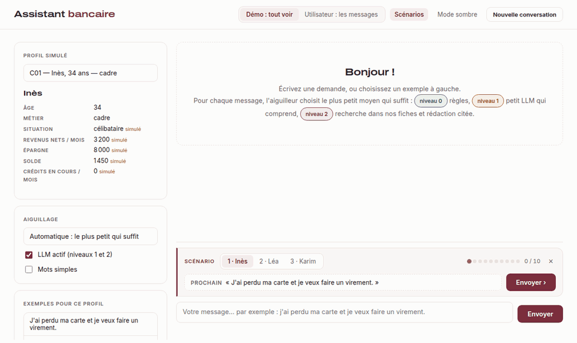
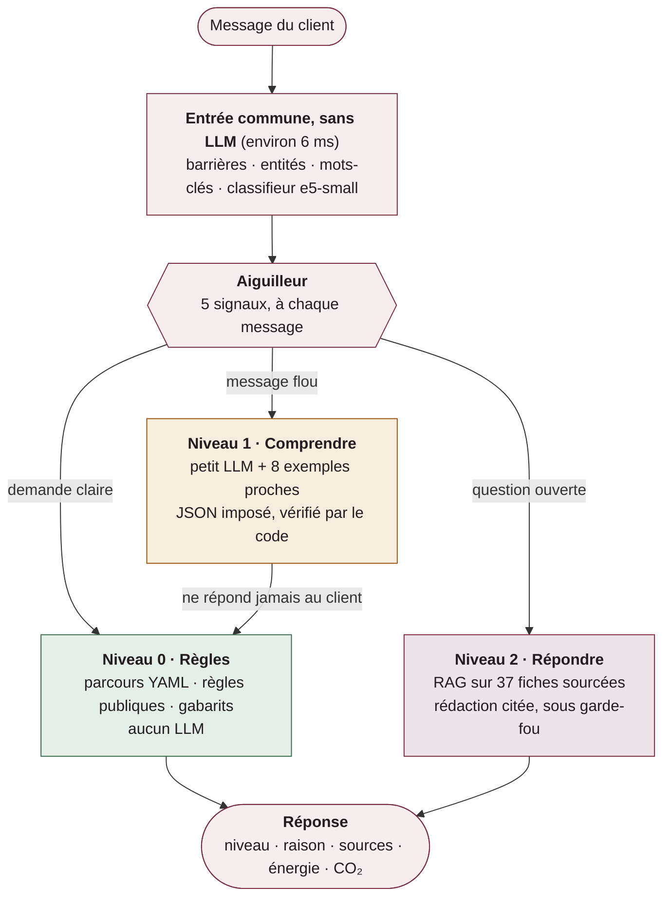
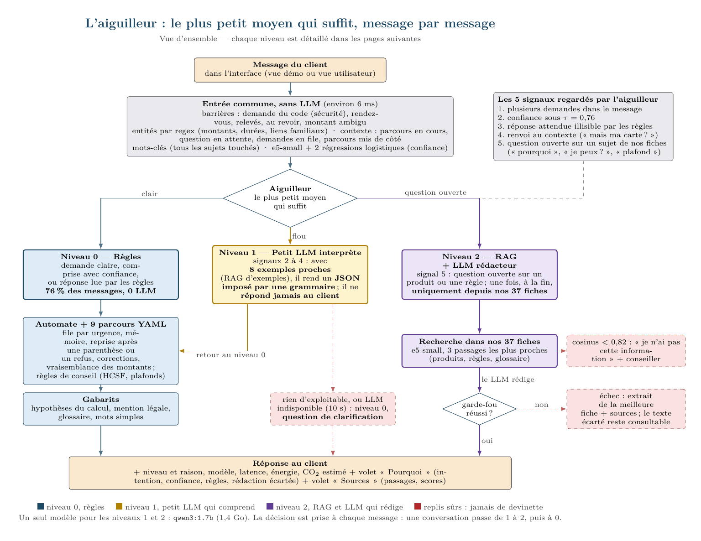
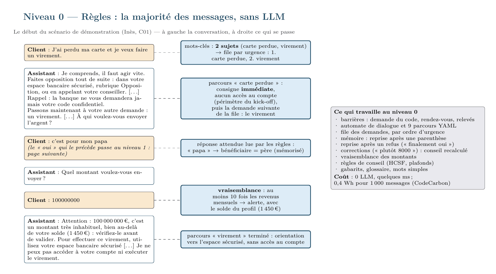
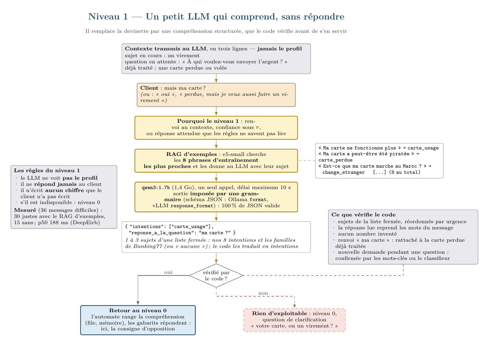
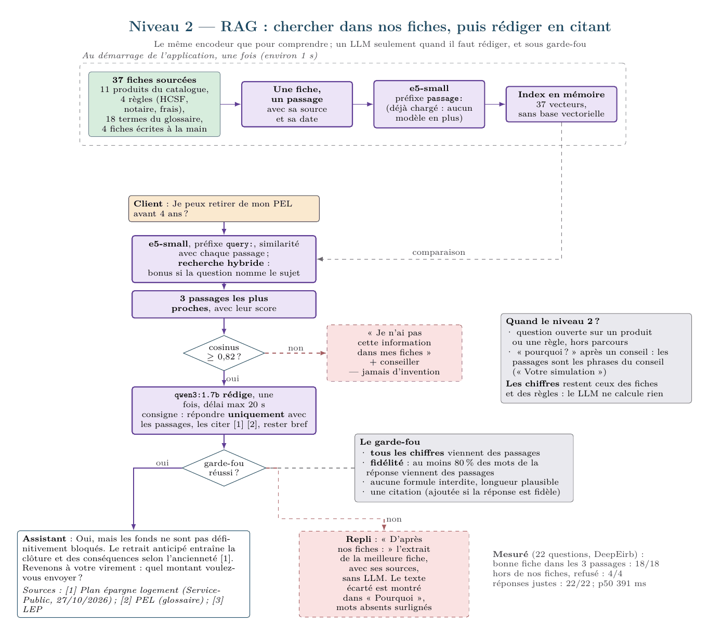
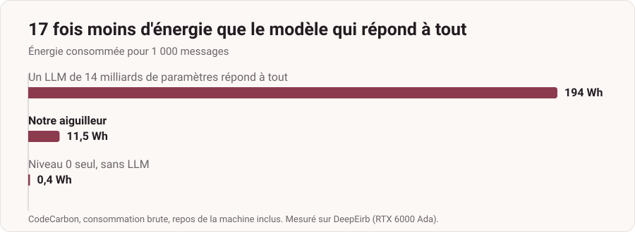
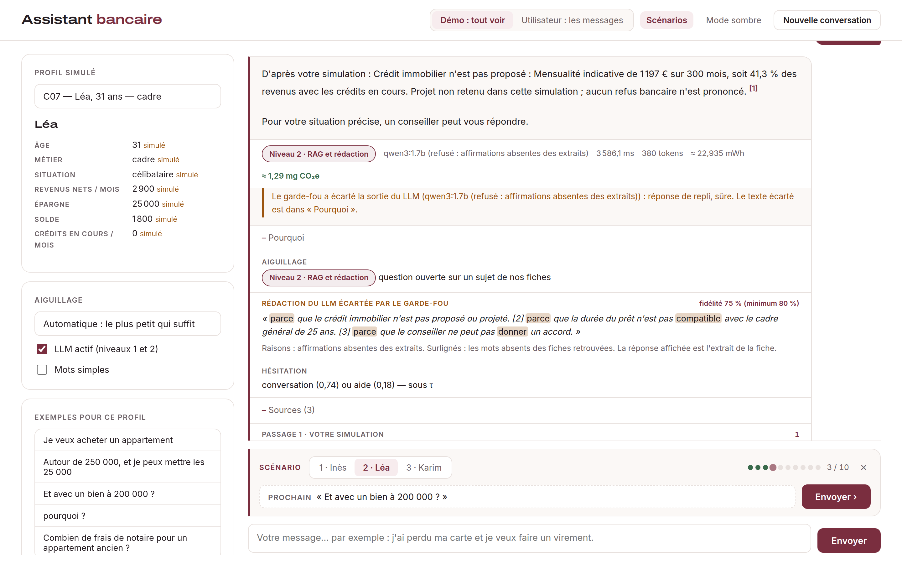
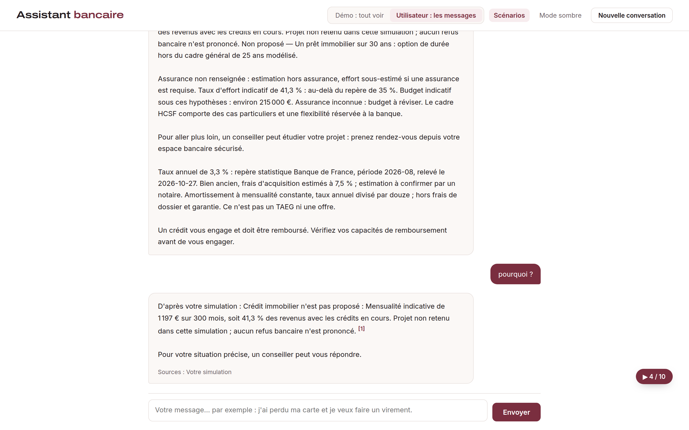

<div align="center">



<br>

**Un assistant bancaire local et explicable, qui n'appelle un LLM que lorsqu'il en a vraiment besoin.**

[](#démarrage-rapide) [](#linterface) [](#stack) [](#choisir-le-modèle-en-descendant-en-taille) [](#tests-et-mesures) [](#tests-et-mesures)

[La démo](#la-démo) · [Comment ça marche](#comment-ça-marche) · [Résultats](#résultats-mesurés) · [Démarrage rapide](#démarrage-rapide) · [Limites](#limites)

<br>

<table>
<tr>
<td align="center" width="25%"><h3>76 %</h3>des messages traités<br><b>sans aucun LLM</b></td>
<td align="center" width="25%"><h3>17×</h3><b>moins d'énergie</b> qu'un LLM<br>de 14 milliards de paramètres</td>
<td align="center" width="25%"><h3>1,4 Go</h3>un seul petit modèle<br>pour <b>tous les appels</b></td>
<td align="center" width="25%"><h3>0,5 s</h3>de latence p95,<br>contre <b>2,3 s</b></td>
</tr>
</table>

<sub>Mesuré sur DeepEirb (RTX 6000 Ada) avec CodeCarbon, sur le banc de scénarios. Méthode et limites plus bas.</sub>

</div>

<br>

## Le problème

Un client écrit à sa banque :

> *« Je veux acheter un appartement. »*<br>
> *« J'ai perdu ma carte hier soir, je fais quoi ? »*<br>
> *« Pourquoi j'ai payé 8 € de frais ce mois-ci ? »*

L'assistant doit comprendre, poser les bonnes questions, tenir compte de la situation du client et proposer une piste adaptée. Le tout avec une contrainte forte, celle du hackathon **La Banque Postale × CGI × ENSEIRB-MATMECA** : **open source, local, le plus petit modèle qui suffit, et une frugalité mesurée**.

Faire répondre un gros LLM à chaque message serait simple. Ce serait aussi coûteux, lent, et impossible à garantir : rien n'empêcherait le modèle d'inventer un taux ou un plafond.

## L'idée

**Le vélo pour aller chercher le pain, la voiture pour le week-end.**

À chaque message, un **aiguilleur** choisit le plus petit moyen qui suffit. C'est du code, sans LLM. La plupart des demandes se règlent avec des règles, en quelques millisecondes. Le petit LLM n'intervient qu'à deux moments précis : pour **comprendre** un message flou, ou pour **rédiger** une réponse à partir de fiches sourcées.

La décision est prise **à chaque message** : une même conversation passe du niveau 1 au niveau 2, puis au niveau 0. La mémoire est commune aux trois niveaux, et après une parenthèse, l'assistant reprend là où il en était.

<br>

## La démo

<div align="center">



<sub>La vraie interface, enregistrée sur un portable sans GPU. L'attente du LLM (2 à 4 s par appel sur processeur) est raccourcie ; sur GPU, elle est de 0,2 à 0,4 s.</sub>

</div>

Dans ce début de conversation, chaque message montre un comportement différent :

| Message d'Inès | Niveau | Ce qui se passe |
|---|:---:|---|
| « J'ai perdu ma carte et je veux faire un virement. » | **0** | Deux demandes détectées : **l'urgence d'abord**, puis le virement |
| « oui » | **1** | Ce n'est pas une réponse lisible : le petit LLM comprend, la question est reposée avec des exemples |
| « c'est pour mon papa » | **0** | Les règles lisent « papa » et retiennent le bénéficiaire |
| « Je peux retirer de mon PEL avant 4 ans ? » | **2** | Réponse citée depuis nos fiches, puis **« Revenons à un virement »** |
| « 100000000 » | **0** | Montant invraisemblable : alerte, avec le solde du client |
| « mais ma carte ? » | **1** | Renvoi au contexte : rattaché à la carte perdue déjà traitée |

<br>

## Comment ça marche



### Les trois niveaux

| | Quand | Comment | Coût |
|---|---|---|---|
| **0 · Règles** | La demande est claire | Mots-clés ou classifieur au-dessus du seuil, 9 parcours YAML, règles métier publiques, gabarits écrits par l'équipe | Aucun LLM |
| **1 · Comprendre** | Message flou, réponse libre, renvoi au contexte | Un petit LLM lit le message avec 8 exemples proches et rend un JSON vérifié par le code. **Il ne parle jamais au client** | 1 appel |
| **2 · Répondre** | Question ouverte sur un produit ou une règle | Recherche dans 37 fiches sourcées, rédaction citée, garde-fou sur les chiffres et la fidélité. Sinon, l'extrait de la fiche | 1 appel |

### L'aiguilleur : cinq signaux, calculés sans LLM

1. **Plusieurs demandes** dans le message : traitées par ordre d'urgence.
2. **Confiance sous le seuil** du classifieur (τ = 0,76) : on ne devine jamais.
3. **Réponse libre** que les règles ne savent pas lire.
4. **Renvoi au contexte** : « mais ma carte ? », « et pour mon fils ? ».
5. **Question ouverte** sur un sujet de nos fiches : « pourquoi ? », « je peux… ? ».

### Trois garanties contre l'invention

- **JSON imposé par une grammaire.** Au niveau 1, le serveur d'inférence ne peut produire qu'un JSON conforme au schéma, avec des sujets pris dans une liste fermée. Résultat mesuré : **100 % de JSON valide**, même avec un modèle de 1 milliard de paramètres.
- **Deux RAG, deux rôles.** Le RAG d'exemples aide le petit LLM à classer par analogie (il **double sa justesse**). Le RAG de fiches lui donne la matière de sa réponse, et rien d'autre.
- **Garde-fou vérifié par le code.** Tous les chiffres doivent venir des fiches, et 80 % des mots aussi. Sinon, la rédaction est écartée et le client reçoit l'extrait de la fiche. L'interface montre le texte refusé, mots absents surlignés.

<details>
<summary><b>Voir les schémas détaillés de chaque niveau</b></summary>

<br>

**Vue d'ensemble**



**Niveau 0 : règles**



**Niveau 1 : un petit LLM qui comprend, sans répondre**



**Niveau 2 : chercher dans nos fiches, puis rédiger en citant**



</details>

<br>

## Résultats mesurés

<div align="center">

</div>

<br>

### Frugalité

| Configuration | Scénarios | Wh / 1 000 messages<br><sub>repos soustrait</sub> | Wh / 1 000 messages<br><sub>brut</sub> | Latence p95 | Mémoire | Sans LLM |
|---|:---:|---:|---:|---:|---:|---:|
| **A** · `ministral-3:14b` répond à tout | à juger | 115,4 | 194,3 | 2,3 s | 9,1 Go | 0 % |
| **B · Notre aiguilleur** (`qwen3:1.7b`) | **15/15** | **5,5** | **11,5** | **0,53 s** | **1,9 Go** | **76 %** |
| **C** · Niveau 0 seul | 15/15 | 0,18 | 0,40 | 19 ms | 0,5 Go | 100 % |

Chaque réponse affiche son énergie et son CO₂ estimés : environ **10 µg de CO₂e sans LLM**, environ **1,3 mg avec un appel**. Ces valeurs viennent des mesures par type de message, multipliées par l'intensité carbone du réseau français retenue par CodeCarbon (56 g de CO₂e par kWh).

<sub>CodeCarbon hors ligne, lots de 200 messages répétés 3 fois après chauffe (40 messages pour A), puissance au repos mesurée à part. Le « 17 fois » utilise les valeurs brutes, les moins favorables.</sub>

### Compréhension

Banking77 **n'a pas été traduit** : l'encodeur multilingue place une phrase anglaise et sa traduction au même endroit. On entraîne en anglais, on comprend le français.

| Configuration | Anglais (77 intentions) | Français (250 phrases jamais vues) | Latence p50 | Taille |
|---|:---:|:---:|---:|---:|
| *Référence : BERT affiné (article Banking77)* | *93,7 %* | — | — | *0,44 Go* |
| Mots-clés seuls | — | 19,2 % acceptés, **100 % justes** | < 0,1 ms | 2 Ko |
| TF-IDF + régression logistique | 89,2 % | 66,8 % | 0,3 ms | 3,9 Mo |
| **e5-small + régression logistique** | **92,3 %** | **84,8 %** | 6,3 ms | 471 Mo |
| **Mots-clés, puis e5-small au-dessus de τ** | — | **76,4 % compris, 96,9 % justes** | 6,1 ms | — |
| `ministral-3:14b` qui classe seul | famille : 52,9 % | 83,2 % | 77,6 ms | 9,1 Go |
| `qwen3:1.7b` qui classe seul | famille : 6,8 % | 29,2 % | 17,7 ms | 1,4 Go |

Un petit LLM seul ne sait pas classer. C'est pour ça qu'il n'est appelé qu'avec des exemples, une grammaire et une vérification par le code.

### Choisir le modèle en descendant en taille

**`qwen3:1.7b` (1,4 Go) est retenu pour les deux niveaux** : c'est le plus petit qui tient le niveau 1, et le seul à 22/22 au niveau 2. Un seul modèle est chargé.

<table>
<tr><th>Niveau 1 : 36 messages difficiles</th><th>Niveau 2 : 22 questions</th></tr>
<tr><td valign="top">

| Modèle | Avec RAG | Sans | p50 |
|---|:---:|:---:|---:|
| `gemma3:1b` · 0,8 Go | 17 | 16 | 454 ms |
| **`qwen3:1.7b` · 1,4 Go** | **30** | 15 | **188 ms** |
| `ministral-3:3b` · 3 Go | 33 | 31 | 250 ms |
| `gemma4:e2b` · 4,6 Go | 29 | 23 | 217 ms |
| `ministral-3:8b` · 6 Go | 31 | 31 | 264 ms |

</td><td valign="top">

| Rédaction | Justes | Acceptées | p50 |
|---|:---:|:---:|---:|
| Sans LLM (extrait) | 21 | — | 12 ms |
| `gemma3:1b` | 21 | 1/18 | 355 ms |
| **`qwen3:1.7b`** | **22** | **9/18** | **391 ms** |
| `ministral-3:3b` | 21 | 3/18 | 476 ms |
| `gemma4:e2b` | 21 | 9/18 | 300 ms |
| `ministral-3:8b` | 21 | 4/18 | 703 ms |

</td></tr>
</table>

Au niveau 2, la recherche trouve la bonne fiche parmi 3 passages **18 fois sur 18**, et refuse les questions hors de nos fiches **4 fois sur 4**. Les gros modèles réécrivent plus librement, donc le garde-fou les écarte plus souvent : **plus gros ne veut pas dire plus fidèle**.

La méthode complète est dans [`infos/choix-modeles-niveaux.md`](infos/choix-modeles-niveaux.md).

### Sur des conversations imprévues

Les bancs ne disent pas tout. Nous avons donc écrit **30 conversations de 10 messages jamais vues pendant le développement**, volontairement difficiles : langage SMS, fautes lourdes, anglais, fraude, deuil, colère, messages vides.

**Environ une réponse sur deux est jugée juste** (jugement à la main, réponse par réponse). Les demandes claires, les parcours guidés et les questions sur nos fiches tiennent bien ; les causes d'échec sont listées dans les [limites](#limites). Tout est consultable, réponse par réponse : [`eval/resultats/conversations-nouvelles.md`](eval/resultats/conversations-nouvelles.md).

<br>

## Chaque réponse se justifie

Léa, 31 ans, 2 900 € nets par mois, veut acheter un appartement à 250 000 € avec 25 000 € d'apport :

> **Non proposé — Crédit immobilier** : mensualité indicative de 1 197 € sur 300 mois, soit **41,3 % des revenus** avec les crédits en cours. Projet non retenu dans cette simulation ; aucun refus bancaire n'est prononcé.
>
> **Non proposé — Un prêt immobilier sur 30 ans** : option de durée hors du cadre général de 25 ans modélisé.

Le calcul se vérifie à la main : 41,3 % dépasse le repère de 35 % du HCSF. L'assistant dit ce qu'il propose, **ce qu'il écarte et pourquoi**, avec ses hypothèses et ses sources datées. À 200 000 €, le taux tombe à 32,2 % et un conseiller peut étudier le projet.

- **Un niveau et une raison** sur chaque réponse.
- **Le « pourquoi ? »** expliqué à partir du conseil lui-même.
- **Des sources** : Service-Public, HCSF, Banque de France, notaires, Trésor, relevées le 27 octobre 2026.
- **Des règles publiques**, pas un score opaque.

## Confiance et périmètre

| Principe | En pratique |
|---|---|
| **Aucun accès au compte** | L'assistant explique, conseille et oriente. Il n'exécute aucune opération, et rappelle de ne jamais donner son code |
| **Aucune décision de crédit** | Il estime sous hypothèses. Un conseiller décide. Pas de notation de solvabilité, un usage à haut risque selon le règlement européen sur l'IA |
| **Des LLM encadrés** | Au niveau 1, le LLM ne voit pas le profil et ne répond pas. Au niveau 2, il n'écrit qu'à partir des fiches, sinon « je n'ai pas cette information » |
| **Rien ne sort de la machine** | Modèles locaux, aucune API externe, données simulées |
| **Inclusion** | Mots simples automatiques dès 70 ans, jargon expliqué, offre clientèle fragile |

<br>

## L'interface

Deux vues, une bascule : tout voir pour comprendre, ou seulement les messages, comme le verrait un client.

<table>
<tr>
<td width="50%" valign="top"><br><sub><b>Vue démo.</b> Ici, le garde-fou écarte une rédaction du LLM : fidélité de 75 % pour un minimum de 80 %, mots absents surlignés.</sub></td>
<td width="50%" valign="top"><br><sub><b>Vue utilisateur.</b> La conversation seule, avec ses sources.</sub></td>
</tr>
</table>

- **Sous chaque réponse** : niveau, modèle, latence, énergie, CO₂, puis « Pourquoi », « Sources » et « Étapes mesurées ».
- **Le panneau de gauche** : profil, niveau forcé pour la démonstration, chaîne des niveaux de la conversation.
- **La barre de scénario** : trois conversations de 10 messages, dont chaque message est tapé puis envoyé d'un clic ou avec la flèche →.

| Scénario | Client | Ce qu'il montre |
|---|---|---|
| `?scenario=1` | Inès, 34 ans | L'aiguilleur passe d'un niveau à l'autre |
| `?scenario=2` | Léa, 31 ans | Conseil, « pourquoi », fiches citées |
| `?scenario=3` | Karim, 29 ans | Crédit, corrections, plusieurs sujets |

<br>

## Démarrage rapide

Il faut **Python 3.10 ou plus** et [**Ollama**](https://ollama.com/download).

```bash
git clone https://github.com/yahyabmo/hackathon-IA.git
cd hackathon-IA

MODELES="qwen3:1.7b" ./installer.sh cpu   # portable ; ./installer.sh sur un poste à GPU
source .venv/bin/activate
ASSISTANT_LLM=1 python -m src.web
```

Attendez `Préchargement de qwen3:1.7b : prêt`, puis ouvrez **http://localhost:8000/?scenario=1**.

`installer.sh` crée l'environnement, télécharge l'encodeur et le modèle, puis lance les tests et les scénarios. Sans `MODELES`, il télécharge tous les modèles des bancs, dont un de 9 Go.

> **Sans LLM ?** `python -m src.web` suffit. L'aiguilleur reste au niveau 0 et le RAG répond par l'extrait de la fiche.

<details>
<summary><b>Les variables utiles</b></summary>

<br>

| Variable | Rôle |
|---|---|
| `ASSISTANT_LLM=1` | Active les niveaux 1 et 2 |
| `OLLAMA_MODEL_NIVEAU1`, `OLLAMA_MODEL_NIVEAU2` | Changent le modèle de chaque niveau |
| `LLM_DELAI_NIVEAU1`, `LLM_DELAI_NIVEAU2` | Délais maximum (10 s et 20 s par défaut) |
| `PORT`, `HOTE` | Adresse du serveur (8000 et 0.0.0.0 par défaut) |
| `ASSISTANT_REFORMULER=1` | Reformulation des conseils par un LLM, mesurée puis écartée |

Adresses de l'interface : `?client=C07`, `?rejouer`, `?scenario=2`, `?utilisateur`, `?demo`.

</details>

### Tests et mesures

```bash
python -m pytest -q             # 153 tests
python -m eval.run_scenarios    # 15 conversations de bout en bout

# Rejouer des conversations libres et écrire un rapport, réponse par réponse
ASSISTANT_LLM=1 python -m eval.rejouer_conversations

# Sur un poste à GPU
./mesurer.sh niveaux            # le plus petit modèle qui tient chaque niveau
./mesurer.sh comprendre         # compréhension, en anglais et en français
./mesurer.sh abc qwen3:1.7b     # énergie, latence et mémoire : A, B, C
```

<br>

## Sous le capot

### Stack

| Brique | Choix | Pourquoi |
|---|---|---|
| Encodeur | [`multilingual-e5-small`](https://huggingface.co/intfloat/multilingual-e5-small) | Multilingue, 118 M de paramètres, quelques ms même sur processeur |
| Classifieur | Régressions logistiques (scikit-learn) | Têtes de 141 Ko, des probabilités exploitables pour le seuil τ |
| LLM | `qwen3:1.7b` via Ollama (ou vLLM) | Le plus petit qui tient chaque niveau, mesuré |
| Dialogue | Automate et 9 parcours YAML | Lisibles, déterministes, modifiables sans toucher au code |
| Conseil | Règles Python, paramètres sourcés | Vérifiables à la main |
| Interface | FastAPI et une page HTML | Léger, sans dépendance côté navigateur |
| Mesure | CodeCarbon, chronométrage par étape | Exigé par le sujet, et utile |

### Données

| Base | Taille | Rôle |
|---|---:|---|
| [Banking77](https://arxiv.org/abs/2003.04807) | 10 003 + 3 080 phrases anglaises | Entraîner le classifieur, sans traduction |
| Exemples de l'équipe | 672 phrases françaises | Nos 8 intentions de conseil et le RAG d'exemples |
| Test français | 250 phrases | Mesurer la compréhension sur du jamais vu |
| Profils clients | 8 personnages fictifs | Personnaliser, avec la provenance de chaque champ |
| Catalogue | 12 produits sourcés et datés | Les règles du conseiller |
| Fiches du RAG | 37 fiches | Les seules sources du niveau 2 |

Les profils sont fictifs. Ils sont rattachés à [Bank Marketing](https://archive.ics.uci.edu/dataset/222/bank+marketing) pour la traçabilité, sans la colonne `duration`, connue seulement après l'appel.

<details>
<summary><b>La structure du dépôt</b></summary>

<br>

```text
├── src/
│   ├── assistant.py       reply() : entrée commune, aiguillage, niveaux, mémoire
│   ├── aiguilleur.py      les 5 signaux, le choix du niveau, l'ordre d'urgence
│   ├── rag.py             niveau 2 : fiches, index, recherche, rédaction, garde-fou
│   ├── llm.py             Ollama ou vLLM, sortie contrainte, délais
│   ├── comprendre/        mots-clés, entités, classifieur, interprète (niveau 1)
│   ├── converser/         automate, parcours YAML, formulation, glossaire
│   ├── conseiller/        profils, catalogue, règles métier
│   ├── mesure/            latence par étape
│   └── web/               interface et scénarios de démonstration
├── data/                  Banking77, Bank Marketing, données préparées
├── eval/                  bancs, scénarios, conversations libres, résultats
├── rapport/               support, démo de secours, schémas
├── infos/                 cadrage du hackathon, méthode de mesure
├── tests/
├── installer.sh           installation de zéro
└── mesurer.sh             mesures sur le poste à GPU
```

</details>

<br>

## Limites

Nous préférons les mesurer plutôt que de les cacher.

- **Les conversations imprévues restent fragiles.** La première cause d'échec est la question en attente : si le client parle d'autre chose, l'assistant peut reposer sa question plusieurs fois.
- **Le petit LLM se trompe parfois de sujet**, et le classifieur aussi sur certaines tournures libres.
- **Le langage SMS, les nombres en lettres** et certains sujets sensibles, comme le deuil, sont mal traités.
- **Le chiffre de 76 % vient du banc de scénarios.** Sur les conversations volontairement difficiles, environ une réponse sur deux reste au niveau 0.
- **Les bancs sont petits** et écrits par l'équipe : 36 et 22 messages pour les niveaux, 250 phrases pour le français.
- **Tout est simulé** : profils, historiques, système bancaire. Les taux sont des repères statistiques, pas des offres.
- **Le CO₂ par réponse est une estimation**, pas une mesure en direct.

**La suite** : sortir d'une question en attente après une relance sans réponse, accepter un bénéficiaire libre, ajouter un parcours deuil et succession, lire les nombres en lettres, puis la voix et la réponse dans la langue du client.

## L'équipe

| Membre | Module | Contribution |
|---|---|---|
| **Yahya Bel Hajjam** | Aiguilleur, conversation, interface | Architecture, niveaux 1 et 2, automate de dialogue, bancs des niveaux, interface |
| **Sohayb El Yaktini** | Conseiller | Profils, catalogue sourcé, règles métier, scénarios de référence |
| **Younes Bamouss** | Comprendre et mesurer | Mots-clés, entités, classifieur, bancs de compréhension et d'énergie |

## Pour aller plus loin

- [`contexte-complet-presentation.md`](contexte-complet-presentation.md) : tout le projet, de A à Z
- [`infos/choix-modeles-niveaux.md`](infos/choix-modeles-niveaux.md) : la méthode des mesures
- [`eval/resultats/`](eval/resultats/) : les résultats bruts
- [`rapport/demo-secours.pdf`](rapport/demo-secours.pdf) : la démo rejouée par le vrai pipeline
- [`main-resume.pdf`](main-resume.pdf) : la proposition initiale

<br>

<div align="center">

Réalisé pendant le **hackathon IA La Banque Postale × CGI × ENSEIRB-MATMECA**, du 26 au 28 octobre 2026.

<sub>Merci aux organisateurs et à toutes les personnes qui nous ont accompagnés. Polices de l'interface : Inter et Archivo (SIL Open Font License).</sub>

</div>
